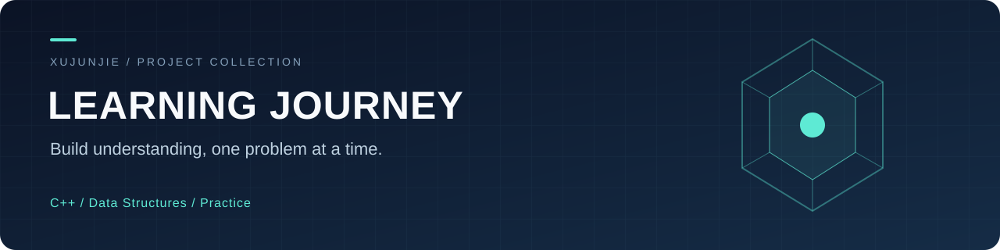

# 算法与数据结构 · Learning Journey
> 记录从教材练习到竞赛题目的 C++ 学习过程。

**C++ · 数据结构 · 搜索与回溯 · 分治 · 蓝桥杯**

## 内容概览

以《算法竞赛入门经典（第 2 版）》为主要学习线索，结合日常刷题、牛客训练与蓝桥杯练习积累代码。下面的导航按照实际目录整理，收录文件不代表对应章节已经全部掌握或完成。

| 方向 | 内容入口 |
| --- | --- |
| 数据结构基础 | [第六章](基础篇/第六章%20数据结构基础/)：栈与队列、铁轨、矩阵链乘等练习 |
| 枚举与回溯 | [第七章](基础篇/第七章%20暴力求解法/)：排列、子集、素数环、困难的串 |
| 高效算法设计 | [第八章](基础篇/第八章%20高效算法设计/)：排序、分治、逆序对、棋盘覆盖 |
| 日常刷题 | [日常刷题](日常刷题/)：DFS、BFS、连通块与无权最短路等 |
| 竞赛练习 | [牛客寒假训练营](牛客寒假训练营/)、[蓝桥杯](蓝桥杯/) |
| 学习笔记 | [notes](notes/) |

## 推荐阅读

- **递归与搜索**：比较排列、子集与回溯题中“状态如何表示、何时结束、如何撤销选择”。
- **分治与排序**：结合快排、归并逆序对与最大子段和，观察分解、合并和统计的差别。
- **图搜索**：对照 DFS、BFS、连通块与最短路径题，理解访问标记与队列层次。

## 仓库结构

```text
基础篇/            按教材章节整理的实现
日常刷题/          日常题目与练习
牛客寒假训练营/    训练题代码
蓝桥杯/            蓝桥杯相关练习
notes/             学习笔记
images/            图片预留目录
```

## 使用说明

源文件通常按题目独立编译运行，应结合对应题目的输入输出要求使用。目录中保留部分练习稿、临时文件与输入输出样例；本仓库未提供对所有文件的统一编译或判题保证。

需要按知识点阅读的复盘与模板，可继续查看 [算法竞赛进阶指南学习库](https://github.com/xujunjie-coder/algorithm-learning)。

## 许可证

仓库代码按现有 [MIT License](LICENSE) 使用；教材题目与第三方材料的权利归原作者所有。
